# System Architecture

## Overview
TMS Shipment Load Integration Service is a Spring Boot + Apache Camel event-driven integration microservice that replaces TIBCO middleware at Macy's. It consumes logistics events from Kafka (Managed and Confluent) and routes them through typed processors to the Transportation Manager (TM) REST API, with audit feedback published to Google Cloud Pub/Sub.

## Architecture Diagram

```mermaid
graph TB
    subgraph "Message Sources"
        MK[[Managed Kafka<br/>VSP Shipment Topic]]
        CK[[Confluent Kafka<br/>Confluent Shipment Topic]]
        PS_IN[[Google Pub/Sub<br/>AppointmentShipConfirm]]
        LTL_IN[[LTL Event Route<br/>supplychain.tmsintg.ltl]]
    end

    subgraph "Application Boundary"
        subgraph "Camel Route Layer"
            ISR[InboundShipmentRouteBuilder<br/>feature.shipment.enabled]
            SCR[ShipConfirmRouteBuilder<br/>feature.ship.confirm.enabled]
            LER[LTLEventRouteBuilder]
            TDR[TrailerDoorDockCdcRouteBuilder]
            TIR[TrailerImageAttachRouteBuilder]
            PGR[PhotoGrabberRouteBuilder]
            OR[OrdersRouteBuilder]
            UTR[UpdateTMRouteBuilder]
        end

        subgraph "Processor Layer"
            SEP[ShipmentEventProcessor<br/>route/event dispatch]
            CSP[CreateShipmentProcessor]
            DSP[DeleteShipmentProcessor]
            SCP[ShipConfirmProcessor]
            LEP[LTLLoadEventProcessor]
            TDP[TrailerDoorDockCdcEventProcessor]
            TIP[TrailerImageAttachProcessor]
            PGP[PhotoGrabberProcessor]
            OHP[OrdersHubCheckProcessor]
            UTP[UpdateTMProcessor]
        end

        subgraph "Service Layer"
            ISS[InBoundShipmentService]
            LTS[LTLTrackingMessageService]
            LES[LoadEnrichmentService]
            TDS[TrailerDockDoorService]
            TDS2[TrailerDoorDockCdcEventService]
            PGS[PhotoGrabberService]
            OS[OrderService]
            LSC[LocationServiceClient]
        end

        subgraph "Infrastructure Layer"
            RC[TMRestApiClient<br/>RestTemplate + CyberArk]
            CU[CommonUtil<br/>Pub/Sub publish helpers]
            LM[LoadMapper<br/>JAXB / domain mapping]
        end
    end

    subgraph "External Systems"
        TM[Transportation Manager<br/>REST API]
        GCS[(Google Cloud Storage<br/>Photo assets)]
        CYBERARK[CyberArk<br/>Secrets Vault]
    end

    subgraph "Audit & Observability"
        AUDIT[[Google Cloud Pub/Sub<br/>Audit Feedback Topics]]
        PROM[Prometheus<br/>Micrometer metrics]
    end

    MK --> ISR --> SEP --> CSP & DSP
    CK --> ISR
    PS_IN --> SCR --> SCP
    LTL_IN --> LER --> LEP
    TDR --> TDP
    TIR --> TIP
    PGR --> PGP
    OR --> OHP
    UTR --> UTP

    CSP & DSP --> ISS
    SCP & UTP --> LES & LM
    LEP --> LTS
    TDP --> TDS & TDS2
    TIP --> TDS
    PGP --> PGS
    OHP --> OS

    ISS & LTS & LES & TDS & TDS2 & PGS & OS --> RC
    RC --> CYBERARK
    RC --> TM

    PGP --> GCS
    CU --> AUDIT
    ISR & SCR & LER & TDR & TIR --> CU
    UTP --> PROM
```

## Layer Summary

| Layer | Purpose | Key Components |
|-------|---------|----------------|
| Message Sources | Ingest events from Kafka (Managed/Confluent) and Pub/Sub | Managed Kafka, Confluent Kafka, GCP Pub/Sub routes |
| Camel Route Layer | Consume topics, apply exception handling, dispatch to processors | 8 RouteBuilders (feature-flagged via ConditionalOnProperty) |
| Processor Layer | Stateless Camel Processors that orchestrate business logic | 10 processors, one per event type |
| Service Layer | Business logic, data enrichment, downstream API calls | 8 service interfaces with Impl classes |
| Infrastructure Layer | HTTP client, secrets, data mapping | TMRestApiClient, CommonUtil, LoadMapper |
| External Systems | Target systems and secrets vault | TM REST API, GCS, CyberArk |
| Audit & Observability | Feedback and telemetry | GCP Pub/Sub audit topics, Prometheus/Micrometer |

## External Integrations

- **Transportation Manager (TM) REST API** — primary sink; receives shipment create/delete, appointment updates, load tender/cancel operations
- **Google Cloud Pub/Sub** — dual role: source (AppointmentShipConfirm route) and sink (audit feedback for all event types)
- **Google Cloud Storage** — photo/image asset storage accessed by PhotoGrabberProcessor
- **CyberArk Password SDK** — runtime secret retrieval for TM API credentials (no hardcoded secrets in config)
- **Confluent Kafka** — alternative Kafka provider for shipment events (feature-flag controlled by `kafka.mode`)
