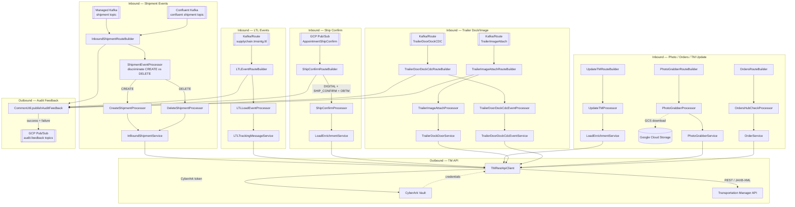

# Data Flow

## Overview
Data enters as JSON events on Kafka topics (Managed or Confluent) or Google Pub/Sub, flows through a Camel route for routing and exception policy, through a typed Processor for validation and orchestration, into a Service for business logic and downstream API calls, and exits as REST calls to Transportation Manager. Audit feedback for all event outcomes is published back to GCP Pub/Sub.

## Data Flow Diagram

## Data Pipelines

| Pipeline | Source | Processing | Destination |
|----------|--------|-----------|-------------|
| Shipment Create | Kafka (shipment topic) | JSON → ShipmentEnterpriseMessage DTO → validate → InBoundShipmentService | TM REST API (create shipment) |
| Shipment Delete | Kafka (shipment topic) | JSON → ShipmentEnterpriseMessage → DeleteShipmentProcessor | TM REST API (delete shipment) |
| Ship Confirm | GCP Pub/Sub | JSON → header filter (DIGITAL+SHIP_CONFIRM+OBTM) → ShipConfirmProcessor | TM REST API (update appointment) |
| LTL Load Event | Kafka (LTL topic) | LTL message → LTLLoadEventProcessor → LTLTrackingMessageService | TM REST API |
| Trailer Dock CDC | Kafka/CDC | CDC event → TrailerDoorDockCdcEventProcessor | TM REST API (dock/door update) |
| Trailer Image | Kafka | Image event → TrailerImageAttachProcessor → TM + GCS | TM REST API (image attach) |
| Photo Grabber | Scheduled/Route | GCS photo download → PhotoGrabberProcessor | TM REST API (photo update) |
| Audit Feedback | All routes (error/success) | CommonUtil → AuditFeedback DTO | GCP Pub/Sub (audit topics) |
| Dock Door Cleanup | Quartz schedule | DockDoorCleanupProcessorService | DB / TM API |

## Integration Points

- **Inbound**: Kafka (Managed Kafka VSP cluster + Confluent Cloud) for shipment/LTL/trailer events
- **Inbound**: GCP Pub/Sub for ship-confirm appointment events
- **Outbound**: Transportation Manager REST API (JAXB XML-bound request/response)
- **Outbound**: GCP Pub/Sub audit feedback topics (3 separate topic configs: shipment, trailer image, dock-door)
- **Outbound**: Google Cloud Storage (photo retrieval)
- **Auth**: CyberArk Password SDK called at request time for TM API credentials
- **Config**: GCP Secret Manager for GCP-managed secrets
