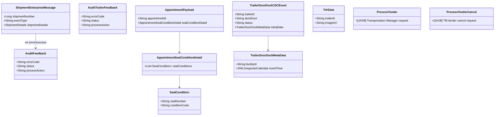

# Data Model

## Overview
The service operates on two distinct data model families: (1) inbound Kafka/Pub/Sub message DTOs (plain Java classes, JSON-serialized) and (2) outbound Transportation Manager API DTOs (~700 JAXB-annotated classes generated from WSDL/XSD). The service does not own a primary relational database schema (JPA is present for dock-door enrichment persistence).

## Entity Relationship Diagram

## Key Entities

| Entity | Purpose | Key Fields | Relationships |
|--------|---------|------------|---------------|
| `ShipmentEnterpriseMessage` | Inbound shipment Kafka event | shipmentNumber, eventType, shipmentDetails | Dispatched to Create/DeleteShipmentProcessor |
| `AppointmentPayload` | Ship-confirm inbound DTO | appointmentId, sealConditionDetail | Used by ShipConfirmProcessor → TM API |
| `AppointmentSealConditionDetail` | Seal condition wrapper | sealConditions list | Owned by AppointmentPayload |
| `SealCondition` | Individual seal record | sealNumber, conditionCode | Part of AppointmentSealConditionDetail |
| `TrailerDoorDockCDCEvent` | CDC event for dock-door | trailerId, dockDoor, status, metaData | Processed by TrailerDoorDockCdcEventProcessor |
| `TrailerDoorDockMetaData` | Event metadata | facilityId, eventTime | Embedded in TrailerDoorDockCDCEvent |
| `TrlrData` | Trailer image data | trailerId, imageUrl | Used by TrailerImageAttachProcessor |
| `AuditFeedback` | Audit outcome DTO | errorCode, status, processAction | Published to GCP Pub/Sub on all events |
| `AuditTrailerFeedback` | Trailer-specific audit DTO | errorCode, status, processAction | Published to trailer audit Pub/Sub topic |
| `dto.gen.transportationmanager.*` | JAXB-generated TM API types (~700 classes) | Per WSDL schema | Sent as XML to TM REST API |

## Data Stores

| Store | Type | Purpose |
|-------|------|---------|
| Kafka (Managed) | Message stream | Inbound shipment/LTL/trailer events from VSP cluster |
| Kafka (Confluent) | Message stream | Inbound shipment events from Confluent Cloud (feature-flagged) |
| Google Cloud Pub/Sub | Message bus | Ship-confirm inbound; audit feedback outbound |
| Google Cloud Storage | Object store | Photo/image assets (read by PhotoGrabberService) |
| Application DB (JPA) | Relational (likely PostgreSQL/Oracle) | Dock-door enrichment data, cleanup scheduling state |
| CyberArk Vault | Secrets store | TM API credentials (not a data store proper) |
| GCP Secret Manager | Secrets store | GCP-managed secrets |
