# Module Dependencies

## Overview
The codebase follows a strict top-down dependency flow: Routes → Processors → Services → Clients. The only lateral dependency is `util.CommonUtil` (Pub/Sub audit publishing) which is shared by both the Route and Processor layers. The JAXB-generated `dto.gen.transportationmanager` package is the highest fan-in dependency after stdlib — it is consumed by the client, mapper, and processors.

## Dependency Graph

```mermaid
graph TD
    subgraph "Entry"
        APP[ShipmentLoadApplication]
    end

    subgraph "Route Layer"
        ISR[InboundShipmentRouteBuilder]
        SCR[ShipConfirmRouteBuilder]
        LER[LTLEventRouteBuilder]
        TDR[TrailerDoorDockCdcRouteBuilder]
        TIR[TrailerImageAttachRouteBuilder]
        PGR[PhotoGrabberRouteBuilder]
        OR[OrdersRouteBuilder]
        UTR[UpdateTMRouteBuilder]
    end

    subgraph "Processor Layer"
        SEP[ShipmentEventProcessor]
        CSP[CreateShipmentProcessor]
        DSP[DeleteShipmentProcessor]
        SCP[ShipConfirmProcessor]
        LEP[LTLLoadEventProcessor]
        TDP[TrailerDoorDockCdcEventProcessor]
        TIP[TrailerImageAttachProcessor]
        PGP[PhotoGrabberProcessor]
        OHP[OrdersHubCheckProcessor]
        UTP[UpdateTMProcessor]
    end

    subgraph "Service Layer"
        ISS[InBoundShipmentService]
        LTS[LTLTrackingMessageService]
        LES[LoadEnrichmentService]
        TDS[TrailerDockDoorService]
        TDS2[TrailerDoorDockCdcEventService]
        PGS[PhotoGrabberService]
        OS[OrderService]
        LSC[LocationServiceClient]
    end

    subgraph "Client Layer"
        RC[TMRestApiClient]
    end

    subgraph "Shared"
        CU[CommonUtil]
        LM[LoadMapper]
        EX[exception.*]
        JAXB[dto.gen.transportationmanager.*]
        IN[dto.inbound.*]
    end

    APP --> ISR & SCR & LER & TDR & TIR & PGR & OR & UTR

    ISR --> SEP & CSP & DSP & CU & EX
    SCR --> SCP & CU
    LER --> LEP & EX
    TDR --> TDP & CU & EX
    TIR --> TIP & CU & EX
    PGR --> PGP & CU
    OR --> OHP
    UTR --> UTP

    SEP --> IN
    CSP & DSP --> ISS & CU & IN & EX
    SCP --> LES & LM
    LEP --> LTS & EX
    TDP --> TDS2 & EX
    TIP --> TDS
    PGP --> PGS & LM & JAXB
    OHP --> OS
    UTP --> LES & LM & JAXB & LSC

    ISS & LTS & LES & TDS & TDS2 & PGS & OS --> RC
    RC --> JAXB
    LM --> JAXB
```

## Coupling Analysis

| Module | Fan-In (depended by) | Fan-Out (depends on) | Assessment |
|--------|----------------------|----------------------|------------|
| `dto.gen.transportationmanager.*` | ~700 internal usages (client, mapper, processors) | JAXB runtime only | **High fan-in** — JAXB changes ripple everywhere; generated, do not edit |
| `util.CommonUtil` | All 8 routes + most processors | GCP Pub/Sub, dto.AuditFeedback | **High fan-in** — shared audit publishing; changing its signature is wide-impact |
| `client.TMRestApiClient` | All 8 service classes | JAXB DTOs, RestTemplate, CyberArk SDK | **Central sink** — every business domain exits through here |
| `mapper.LoadMapper` | ShipConfirm, UpdateTM, PhotoGrabber processors + services | JAXB gen types, enrichment DTOs | **Moderate** — domain mapping hub |
| `service.LoadEnrichmentService` | ShipConfirmProcessor, UpdateTMProcessor | TMRestApiClient, LocationServiceClient | **Moderate** — shared enrichment logic |
| `camel.routes.*` | Spring Boot context only | processors, CommonUtil, exception | **Low fan-in** — route builders are leaf entry points |
| `exception.*` | Routes + Processors | (none) | **Pure sink** — safe to extend |
| `dto.inbound.*` | Shipment processors | (none) | **Low** — Kafka message DTOs, isolated |

## Circular Dependencies

None detected. The layer hierarchy (Routes → Processors → Services → Client) is strictly one-directional.
